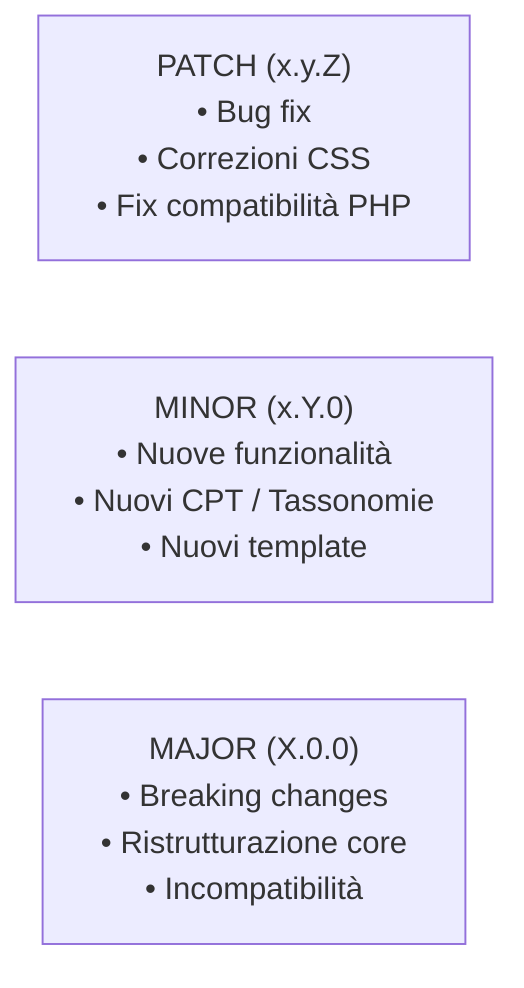
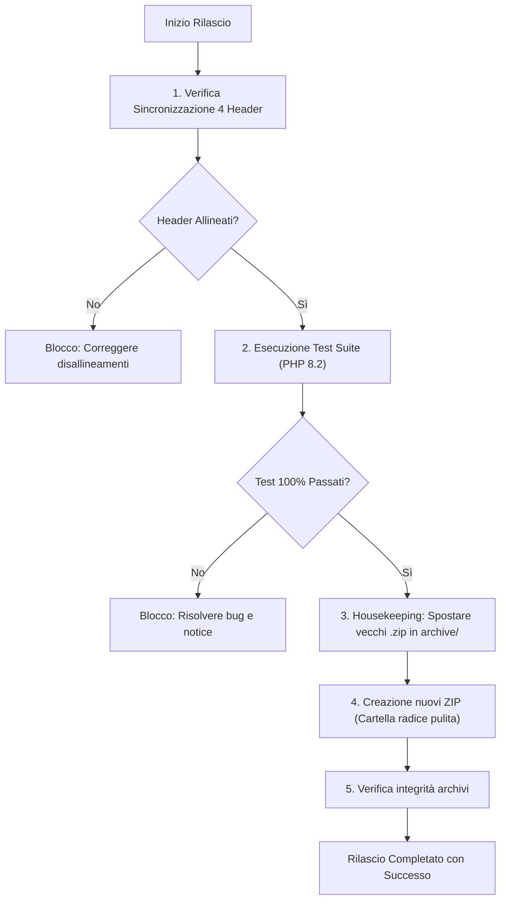

# Regola Operativa: Versioning SemVer, Housekeeping & Packaging Release
# Identificativo: `RULE-OPS-001`

> **Destinatari:** Francesca (CQO), Alessandro (CTO), Elena (Frontend), Mario (Architect), COO / PM  
> **Applicazione:** Tassativa e obbligatoria per ogni singola modifica al codice  
> **Workspace Root:** `c:\Users\Luca-Maiolini\Sviluppo-Antigravity\Ecosistema\Progetti\Divisione_WP\Temi\NTN Journal Refactoring`

---

## 1. Principi di Base e Obiettivi

Questa regola stabilisce la procedura standard per il controllo delle versioni, la sincronizzazione simultanea degli header di progetto, l'archiviazione storica dei file rilasciati (Housekeeping) e la generazione corretta dei pacchetti ZIP per WordPress.

### Obiettivi Primari
1. **Tracciabilità Totale:** Nessun file sorgente modificato deve rimanere con un numero di versione obsoleto o disallineato.
2. **Sincronizzazione Atomica:** Tutti i componenti del sistema (Parent Theme, Child Theme, Core Plugin) devono riflettere la medesima versione coordinata.
3. **Integrità dei Pacchetti ZIP:** Gli archivi ZIP generati devono essere immediatamente installabili su WordPress tramite l'uploader standard di `wp-admin`.
4. **Housekeeping Rigoroso:** La radice del workspace deve contenere esclusivamente i pacchetti ZIP dell'ultima versione; le versioni storiche devono risiedere ordinatamente in `archive/`.

---

## 2. Definizione del Semantic Versioning (SemVer)

La versione dell'ecosistema è definita nel formato:  
$$\text{MAJOR}.\text{MINOR}.\text{PATCH}$$



### Quando incrementare il numero di versione:

| Livello | Quando Applicare | Esempio Prima ➔ Dopo |
|---|---|:---:|
| **PATCH** (`+0.0.1`) | Risoluzione bug, fix edge cases, correzione CSS/UI, piccoli aggiustamenti di sanitizzazione, fix compatibilità PHP 8.2. | `2.1.2` ➔ `2.1.3` |
| **MINOR** (`+0.1.0`) | Aggiunta nuovo Custom Post Type, nuova tassonomia, nuovo modulo/funzionalità nel plugin o nel tema, nuovi layout o template. Reset del contatore PATCH a `0`. | `2.1.3` ➔ `2.2.0` |
| **MAJOR** (`+1.0.0`) | Refactoring architetturale radicale, modifiche breaking al database o alle API, cambio radicale di design framework. Reset dei contatori MINOR e PATCH a `0`. | `2.2.0` ➔ `3.0.0` |

---

## 3. Mappa dei 4 Punti di Sincronizzazione Atomica

Ad ogni avanzamento di versione, lo sviluppatore incaricato e Francesca (CQO) **DEVONO** aggiornare contemporaneamente i seguenti 4 punti:

### 1. Parent Theme Header
- **Percorso:** `NTN_Journal_Theme_Reloaded/ntn-journal/style.css`
- **Pattern:**
  ```css
  /*
  Theme Name: NTN Journal
  ...
  Version: X.Y.Z
  ...
  */
  ```

### 2. Child Theme Header
- **Percorso:** `NTN_Journal_Theme_Reloaded/ntn-journal-reloaded/style.css`
- **Pattern:**
  ```css
  /*
   Theme Name:   NTN Journal Reloaded
   ...
   Template:     ntn-journal
   Version:      X.Y.Z
   ...
  */
  ```

### 3. Core Plugin Header Comment
- **Percorso:** `NTN_Journal_Core_Plugin/ntn-journal-core/ntn-journal-core.php`
- **Pattern:**
  ```php
  <?php
  /**
   * Plugin Name: NTN Journal Core
   * ...
   * Version: X.Y.Z
   * ...
   */
  ```

### 4. Core Plugin Constant
- **Percorso:** `NTN_Journal_Core_Plugin/ntn-journal-core/ntn-journal-core.php`
- **Pattern:**
  ```php
  define( 'NTN_JOURNAL_CORE_VERSION', 'X.Y.Z' );
  ```

---

## 4. Protocollo di Housekeeping & Packaging ZIP di Francesca (CQO)



---

### Step 1: Housekeeping Preventivo
Prima di generare qualsiasi nuovo pacchetto ZIP, tutti i file `.zip` attualmente presenti nella root del workspace devono essere spostati nella cartella `archive/`.

**Comando PowerShell per l'archiviazione:**
```powershell
# Eseguire dalla root del workspace
$archiveDir = "archive"
if (-not (Test-Path $archiveDir)) { New-Item -ItemType Directory -Path $archiveDir }

Get-ChildItem -Path . -Filter "*.zip" | ForEach-Object {
    Write-Host "Archiviazione: $($_.Name) -> $archiveDir"
    Move-Item -Path $_.FullName -Destination $archiveDir -Force
}
```

---

### Step 2: Regole di Struttura Interna degli Archivi ZIP
Ogni archivio ZIP creato per WordPress **deve rispettare tassativamente la struttura a singola cartella radice**:

1. **Tema Parent (`ntn-journal-parent-X.Y.Z.zip`):**
   - Cartella contenuta: `ntn-journal/` (SENZA numero di versione nel nome della cartella)
   - Contenuto: tutti i file di `NTN_Journal_Theme_Reloaded/ntn-journal/`

2. **Tema Child (`ntn-journal-child-reloaded-X.Y.Z.zip`):**
   - Cartella contenuta: `ntn-journal-reloaded/` (SENZA numero di versione nel nome della cartella)
   - Contenuto: tutti i file di `NTN_Journal_Theme_Reloaded/ntn-journal-reloaded/`

3. **Plugin Core (`ntn-journal-core-X.Y.Z.zip`):**
   - Cartella contenuta: `ntn-journal-core/` (SENZA numero di versione nel nome della cartella)
   - Contenuto: tutti i file di `NTN_Journal_Core_Plugin/ntn-journal-core/`

> [!WARNING]  
> Non creare mai archivi con file sparsi nella radice dello zip o con cartelle denominate `ntn-journal-2.1.2/`. WordPress richiede che lo slug della cartella estratta coincida esattamente con lo slug registrato del tema/plugin (`ntn-journal`, `ntn-journal-reloaded`, `ntn-journal-core`).

---

### Step 3: Script Ufficiale PowerShell di Packaging e Verifica

Di seguito lo script PowerShell standardizzato per generare i 3 archivi garantendo l'uso di forward slashes e cartelle corrette:

```powershell
param (
    [Parameter(Mandatory=$true)]
    [string]$Version
)

$WorkspaceRoot = "c:\Users\Luca-Maiolini\Sviluppo-Antigravity\Ecosistema\Progetti\Divisione_WP\Temi\NTN Journal Refactoring"
Set-Location $WorkspaceRoot

# 1. Housekeeping: Spostamento vecchi zip in archive/
$ArchiveFolder = Join-Path $WorkspaceRoot "archive"
if (-not (Test-Path $ArchiveFolder)) { New-Item -ItemType Directory -Path $ArchiveFolder -Force }
Get-ChildItem -Path $WorkspaceRoot -Filter "*.zip" | ForEach-Object {
    Move-Item -Path $_.FullName -Destination $ArchiveFolder -Force
}

# 2. Definizione target
$Packages = @(
    @{
        Source = Join-Path $WorkspaceRoot "NTN_Journal_Theme_Reloaded\ntn-journal"
        ZipName = "ntn-journal-parent-$Version.zip"
        EntryRoot = "ntn-journal"
    },
    @{
        Source = Join-Path $WorkspaceRoot "NTN_Journal_Theme_Reloaded\ntn-journal-reloaded"
        ZipName = "ntn-journal-child-reloaded-$Version.zip"
        EntryRoot = "ntn-journal-reloaded"
    },
    @{
        Source = Join-Path $WorkspaceRoot "NTN_Journal_Core_Plugin\ntn-journal-core"
        ZipName = "ntn-journal-core-$Version.zip"
        EntryRoot = "ntn-journal-core"
    }
)

# 3. Creazione archivi con System.IO.Compression (Forward Slash nativo)
Add-Type -AssemblyName System.IO.Compression
Add-Type -AssemblyName System.IO.Compression.FileSystem

foreach ($pkg in $Packages) {
    $zipPath = Join-Path $WorkspaceRoot $pkg.ZipName
    if (Test-Path $zipPath) { Remove-Item $zipPath -Force }

    $zip = [System.IO.Compression.ZipFile]::Open($zipPath, [System.IO.Compression.ZipArchiveMode]::Create)
    $files = Get-ChildItem -Path $pkg.Source -Recurse -File

    foreach ($file in $files) {
        $relativePath = $file.FullName.Substring($pkg.Source.Length).TrimStart('\', '/')
        $entryName = ($pkg.EntryRoot + "/" + $relativePath).Replace('\', '/')
        [System.IO.Compression.ZipFileExtensions]::CreateEntryFromFile($zip, $file.FullName, $entryName, [System.IO.Compression.CompressionLevel]::Optimal) | Out-Null
    }

    $zip.Dispose()
    Write-Host "Generato con successo: $($pkg.ZipName)"
}
```

---

## 5. Checklist di Conformità Finale per Francesca (CQO)

Prima di apporre il sigillo di qualità e consegnare al COO / PM e al CEO:

- [ ] I 4 header di versione sono stati controllati e hanno lo stesso identico valore.
- [ ] Il test suite (`php audit_test_suite.php`) è stato eseguito senza errori né warning.
- [ ] Tutti i vecchi file `.zip` sono stati spostati nella cartella `archive/`.
- [ ] I 3 nuovi file `.zip` sono presenti nella root del workspace con la nuova versione nel nome file.
- [ ] Ciascuno dei 3 ZIP contiene una singola directory radice (`ntn-journal/`, `ntn-journal-reloaded/`, `ntn-journal-core/`).
- [ ] Tutti i file all'interno degli ZIP utilizzano percorsi con forward slash `/`.
- [ ] È stato preparato il log delle modifiche da allegare alla comunicazione finale.
