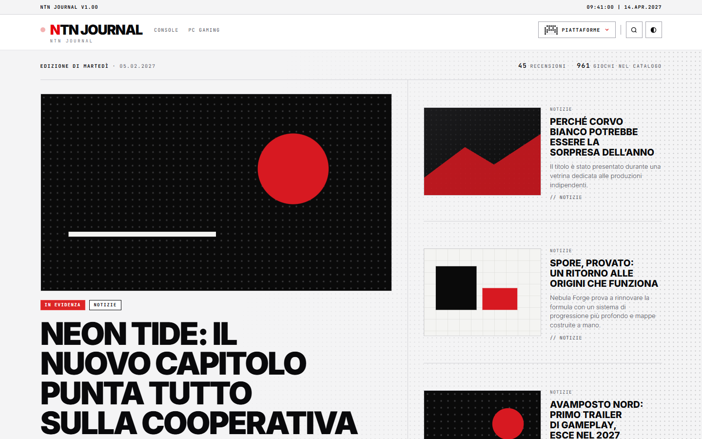
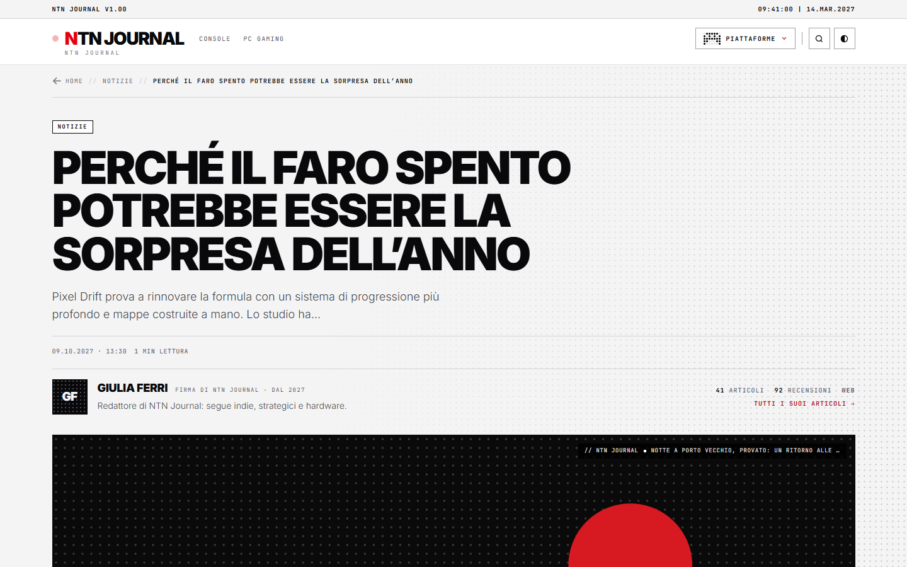
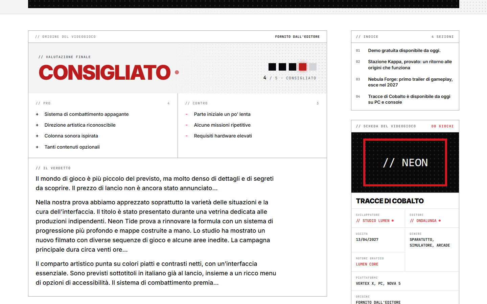
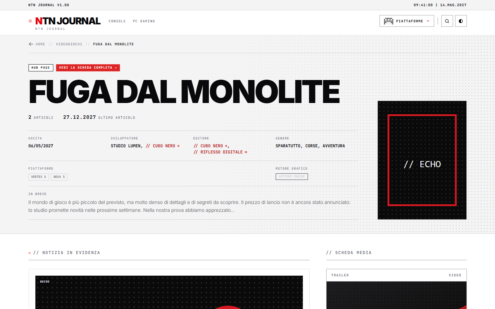
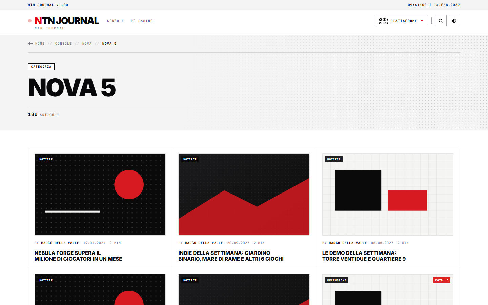
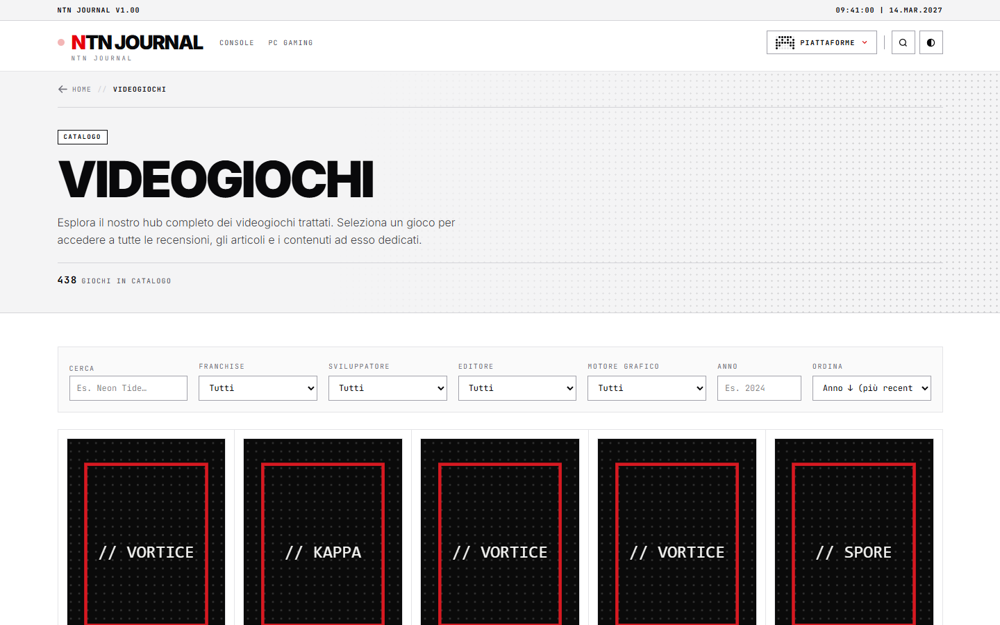
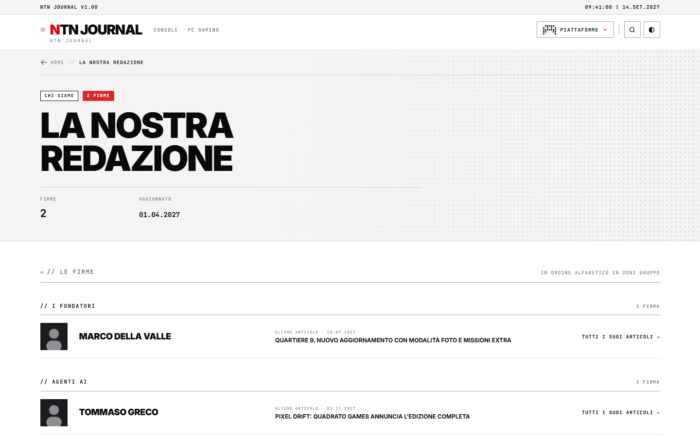
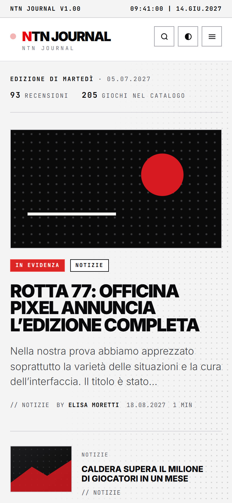

# NTN Journal

Tema WordPress per siti di informazione videoludica, con estetica **brutalista ispirata a Nothing OS**: nero, bianco e rosso, matrice di punti come firma grafica, linee da 1 pixel, angoli vivi, niente ombre né sfumature, tema chiaro e scuro.

È composto da tre pezzi che hanno sempre lo stesso numero di versione:

| Pezzo | Cartella | Ruolo |
|---|---|---|
| **Plugin** `ntn-journal-core` | `NTN_Journal_Core_Plugin/ntn-journal-core/` | Tutti i dati e la logica: tipi di contenuto, tassonomie, IGDB, SEO, redirect, backup, Hub, Redazione, pannello di gestione |
| **Tema parent** `ntn-journal` | `NTN_Journal_Theme_Reloaded/ntn-journal/` | Modelli di pagina (compresi catalogo e Hub del gioco), stile compilato con Tailwind CSS v4, script del sito |
| **Tema child** `ntn-journal-reloaded` | `NTN_Journal_Theme_Reloaded/ntn-journal-reloaded/` | Solo le personalizzazioni del sito (vuoto di proposito dalla 4.10.0) |

Il principio è **"il tema mostra, il plugin pensa"**: il tema legge i dati chiamando funzioni del plugin protette da `function_exists()` (con riserve vuote in `inc/plugin-fallbacks.php`), quindi il sito resta visibile anche a plugin spento. I dati IGDB sono conservati nel sito: le pagine non dipendono da IGDB per essere mostrate.

> **Versione attuale:** 4.34.0 · **Requisiti:** WordPress 6.0+ (provato fino alla 7.x), PHP 8.0+ (provato fino alla 8.5) · **Facoltativo:** The SEO Framework 5.x · **Licenza:** GPL-2.0-or-later

> Le immagini qui sotto sono **mockup**: usano l'HTML e il CSS veri del tema, ma articoli, giochi, studi, autori e immagini sono inventati.



---

## Indice

- [Panoramica delle pagine](#panoramica-delle-pagine)
- [Funzioni del tema parent](#funzioni-del-tema-parent)
- [Funzioni del plugin](#funzioni-del-plugin)
- [Pannello NTN Journal](#pannello-ntn-journal)
- [Installazione e aggiornamento](#installazione-e-aggiornamento)
- [Sviluppo](#sviluppo)
- [Struttura del repository](#struttura-del-repository)

---

## Panoramica delle pagine

### Articolo

Testata sulla fascia a punti con titolo grande e sottotitolo, riga dati in JetBrains Mono (gioco collegato, autore, data, tempo di lettura, "Aggiornato"), foto a tutta larghezza con filigrana, sottotitoli numerati 01, 02…, colonna laterale con indice, scheda del gioco, condivisione e fonti Google. A fine testo: tag, "// Seguici", "// Leggi anche" e commenti.



### Recensione

Box del voto con cinque LED quadrati e voto in numero, etichetta di giudizio (Bocciato, Consigliato con riserva, Consigliato, Must Play), pro e contro uno per riga, verdetto. Nella colonna laterale la **Scheda videogioco**: se l'articolo parla di più giochi diventa una scheda che scorre (frecce e indicatori a LED su computer, schede con i nomi e scorrimento con il dito da telefono), con la riga "Leggi la recensione" o "Non recensito" per ogni gioco.



### Hub del videogioco

Indirizzo `/videogioco/nome-gioco/`. Copertina IGDB in cornice e link "Vedi su IGDB.com", contatori (articoli, recensioni, anteprime, ultimo articolo), scheda tecnica a celle (uscita con la precisione nota, sviluppatore, editore, genere, piattaforme, motore grafico), "// Panoramica" scritta dalla redazione o cella "In breve" automatica, contenuto in evidenza, "// Scheda media" con trailer e screenshot ingrandibili, tutti gli articoli del gioco.



### Hub di categoria

Una categoria si può trasformare in Hub dal pannello. Tipi disponibili:

- **Console, Mobile, PC Gaming**: fascia con disegno a punti, selettore dei marchi, "// Piattaforme" con una scheda per piattaforma, "// In evidenza" (una grande e tre piccole), "// Tutti gli articoli" filtrabili.
- **Studi** (es. "Sviluppatori italiani di videogiochi"): cartina dell'Italia a puntini e "// Indice degli studi" con filtro A–Z.
- **Statistiche**: quattro numeri della sezione (articoli, autore più attivo dell'anno, ultimo articolo, giochi trattati), articolo più recente grande e griglia 3 × 3.

Sul tag di uno studio c'è anche la **Hub dello studio**, con i suoi giochi e i suoi articoli.



### Catalogo dei videogiochi

Totale dei giochi in testata, barra dei filtri che segue lo scorrimento (da telefono si apre con "[ Filtri ]"), griglia a linee condivise da 2 a 5 colonne, filtri senza ricaricare la pagina e salvati nell'indirizzo, scorrimento infinito, ricerca con suggerimenti su giochi e articoli.



### Redazione

Elenco "// Le firme" diviso in gruppi, con ultimo articolo e link di ogni persona; ordine alfabetico, a mano o per numero di articoli.



### Da telefono

<p>
  
  &nbsp;
  
</p>

---

## Funzioni del tema parent

**Pagine.** Home a blocchi (apertura "una grande e tre piccole", ultime notizie, recensioni, editoriali, prossime uscite, fascia Hub con cartina, Twitch e YouTube, contatori dell'edizione), articoli e recensioni, Hub del videogioco, catalogo, Hub di categoria e di studio, comunicati stampa ("Press room" e scheda del comunicato), archivi di categoria, tag, data e ricerca, archivio del motore grafico, pagina autore con i suoi numeri, Redazione, pagine statiche e 404.

**Testata e piè di pagina.** Barra di sistema con testo personalizzabile, orologio e barra **Breaking News**; logo con la prima lettera rossa; menu su una riga con tendina "Piattaforme" a colonne; ricerca; pulsante chiaro/scuro che ricorda la scelta; pannello menu da telefono.

**Articoli.** Box "// Consigliati" inseriti nel testo in base alla lunghezza (mai dentro citazioni, immagini, elenchi o tabelle), "// Leggi anche", "// Condividi" con link nativi senza tracciamenti, "// Seguici" con i profili social, "// Fonti preferite su Google", lightbox GLightbox caricato solo dove serve.

**Opzioni in Aspetto → Personalizza.** Testo della barra superiore, logo o nome del sito, Consigliati e Leggi anche, filigrana sulle immagini, categoria della fascia Hub in Home, cartina dell'Italia, condivisione, blocco Google, profili social.

**Menu e widget.** Quattro posizioni per i menu (Primary, Gestione Contenuti, Gestione Piattaforme, Footer); aree widget Sidebar Principale, Twitch Live e YouTube Hub.

**Stile.** Sorgente unica `build/input.css` compilata con Tailwind CSS v4 in `style-tailwind-output.css`. Caratteri locali **Inter** (lettura) e **JetBrains Mono** (etichette, date, numeri), nessuna chiamata a Google Fonts. Disegni a matrice di punti (console, telefono, PC, cartina dell'Italia) che seguono il tema chiaro o scuro. `theme.json` per l'editor a blocchi.

**Prestazioni.** Script differiti, precaricamento dell'immagine principale e del carattere Inter, preconnessione a IGDB e YouTube, trailer YouTube caricato solo al clic, blocchi della Home in cache e svuotati a ogni pubblicazione.

**Accessibilità.** Etichette per i lettori di schermo, navigazione da tastiera, contrasti controllati.

## Funzioni del plugin

**Tipi di contenuto e tassonomie.** Videogioco (`/videogioco/nome-gioco/`, il cui archivio è il catalogo) e Comunicato stampa; tassonomie Motore grafico, Franchise, Sviluppatori, Editori, Anno di uscita. I tag collegati a un gioco IGDB portano alla Hub del gioco.

**Recensioni.** Voto da 1 a 5, pro, contro, verdetto e gioco recensito (campi registrati con `register_post_meta`), etichette di giudizio, elenco delle "Recensioni senza voto" con il voto proposto dal giudizio.

**IGDB.** Accesso tramite Twitch con token in memoria, ricerca dei giochi dall'editor, collegamento di un tag a un gioco con tutti i suoi dati (copertina, date con la loro precisione, studi, piattaforme, generi, motore, franchise, trailer, screenshot). **Scanner IGDB** per aggiornare, scollegare e riparare i collegamenti; aggiorna solo i giochi cambiati su IGDB.

**Catalogo e ricerca.** Endpoint REST `ntn-journal/v1/games` (filtri e ordinamento per data) e `ntn-journal/v1/live-search` (suggerimenti su giochi e articoli).

**SEO e dati strutturati.** Schema.org (`WebSite`, `BreadcrumbList`, `Review` con `Rating` e `VideoGame`, `VideoObject`, `FAQPage`, `Person`, `Organization`, `ItemList`, `CollectionPage`, `ImageObject`) con interruttore d'emergenza; breadcrumb, indice automatico, Open Graph; integrazione con The SEO Framework (i testi scritti a mano hanno sempre la precedenza); immagine di anteprima adatta a Google Discover; sitemap e sitemap Google News; pagine con pochi articoli tenute fuori da Google con soglie regolabili.

**Redirect.** Singoli 301 o 302 con contatore, per cartella (es. `/category/…` → `/sezione/…`), pagine numerate oltre la fine riportate alla prima, opzione per non far "indovinare" gli indirizzi a WordPress.

**Ottimizzazione del sito.** Immagini caricate ridotte a 1920 px e convertite in JPEG se non trasparenti, PNG trasparenti conservati (con riparazione delle miniature), rapporto di sola lettura sulle immagini, emoji e intestazioni superflue disattivate, XML-RPC spento, blocco dell'enumerazione degli autori.

**Altro.** Riassunti con l'intelligenza artificiale nell'editor (**Google Gemini**, con **Groq** di riserva), verifica delle chiavi API senza mai mostrarle, barra Breaking News, backup e ripristino in JSONL, registro delle memorie (cache) con svuotamento mirato, avviso se plugin e temi hanno versioni diverse.

## Pannello NTN Journal

Voce **NTN Journal** nel menu della bacheca, visibile solo agli amministratori, con 13 schede:

| Scheda | Cosa si fa |
|---|---|
| Dashboard | Stato reale di ogni funzione in un colpo d'occhio |
| Hub | Accendere, modificare e spegnere le Hub di categoria; controllo copertura |
| Redazione | Gruppi, persone e ordine della pagina Redazione |
| Recensioni | Elenco con ricerca e filtri per giudizio, recensioni senza voto |
| Comunicati | Elenco dei comunicati e avviso a fine comunicato |
| Scanner IGDB | Credenziali, collegamenti tra tag e giochi, aggiornamenti, riparazioni, cache |
| Breaking News | Impostazioni della barra |
| Redirect | Redirect singoli e per cartella, pagine oltre la fine |
| Servizi API | Chiavi e stato di Gemini, Groq e IGDB con "Verifica" |
| SEO | Dati strutturati, Open Graph, indice automatico, sitemap News, soglie |
| Extra | Commenti, link ai videogiochi, cache delle Hub, svuotamento della memoria |
| Immagini | Riparazione delle miniature PNG e rapporto sulle immagini |
| Backup | Esportazione e ripristino |

---

## Installazione e aggiornamento

I pacchetti ZIP si creano con lo script di rilascio (vedi sotto) e non sono salvati nel repository.

1. **Plugin:** carica e attiva `ntn-journal-core-X.Y.Z.zip` da **Plugin → Aggiungi nuovo**.
2. **Tema parent:** carica `ntn-journal-parent-X.Y.Z.zip` da **Aspetto → Temi → Aggiungi nuovo**, senza attivarlo.
3. **Tema child:** carica `ntn-journal-child-reloaded-X.Y.Z.zip` e **attiva NTN Journal Reloaded**, che deve restare sempre attivo.

Per aggiornare segui lo stesso ordine: **plugin, parent, child**.

Cancellando il plugin si tolgono solo le memorie (cache) e le operazioni programmate. Per togliere anche impostazioni, chiavi e redirect aggiungi `define( 'NTN_CORE_REMOVE_ALL_DATA', true );` a `wp-config.php` prima di cancellarlo. Articoli, giochi, tag e categorie non vengono mai cancellati.

## Sviluppo

```bash
# CSS: compila build/input.css in style-tailwind-output.css
npm install
npm run build

# Test: suite PHP di collaudo (da eseguire prima di ogni rilascio, esito 100%)
php audit_test_suite.php

# Stile del codice: WordPress Coding Standards
phpcs --standard=phpcs.xml.dist
```

```powershell
# Pacchetti ZIP di plugin, parent e child (Windows PowerShell)
.\package_release.ps1 -Version X.Y.Z
```

Regole principali:

- Ogni modifica al codice porta a una **nuova versione** (SemVer), uguale in plugin, parent e child.
- Il codice nuovo del plugin usa il prefisso `ntn_core_`; i nomi esistenti `ntn_` e `ntn_journal_` non si rinominano.
- Il sito non deve dipendere da IGDB per essere visibile.

## Struttura del repository

```text
.
├── NTN_Journal_Core_Plugin/ntn-journal-core/     Plugin
├── NTN_Journal_Theme_Reloaded/ntn-journal/        Tema parent
├── NTN_Journal_Theme_Reloaded/ntn-journal-reloaded/  Tema child
├── audit_test_suite.php                           Suite di test
├── package.json, package-lock.json                Compilazione CSS (Tailwind CSS v4)
├── package_release.ps1                            Creazione degli ZIP
├── phpcs.xml.dist                                 Regole di stile del codice
├── .github/readme/                                Mockup usati in questo file
└── CLAUDE.md, AGENTS.md, .claude/, .agents/       Regole di lavoro per gli assistenti
```

Documenti di lavoro, note di rilascio e pacchetti ZIP restano solo in locale e non sono tracciati da git.

---

Autori: **Luca Maiolini & Divisione_WP** · Licenza [GPL-2.0-or-later](https://www.gnu.org/licenses/gpl-2.0.html)
