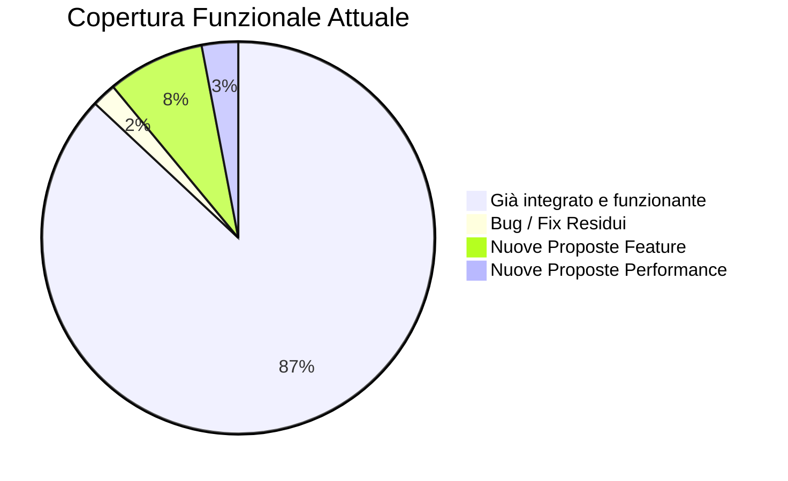

# NTN Journal — Audit Completo & Piano Interventi

> [!NOTE]
> Questo documento è il risultato di un **audit completo del tema NTN Journal** (v1.13.02), aggiornato il 4 agosto 2026. L'analisi copre: **bug**, **sicurezza**, **performance**, **qualità del codice**, **SEO**, **funzionalità completate** e **nuove funzionalità proposte**. Rispetto all'audit originale (v1.5.10), sono stati risolti la quasi totalità dei bug, completata la migrazione da RAWG a IGDB, introdotta l'integrazione multimediale e ristrutturata la governance agentica. L'ultima revisione include la nuova **Strategia di Performance Avanzata**.

---

## 📊 Stato Attuale vs. Copertura Obiettivo (Aggiornato alla v1.13.02)

| Area / Funzionalità | Stato | Note |
|---|---|---|
| SEO & Schema | ✅ Completo | 11 funzioni attive (SEO-01 breadcrumb esteso ancora da completare) |
| Sistema Recensioni | ✅ Completo | Meta box IGDB, rating labels, sidebar multimediale |
| Condivisione Social | ✅ Completo | 8 piattaforme, zero JS |
| Performance & Sicurezza | ✅ Migliorato | Font async, CSS inline spostato, schema ottimizzato |
| AI Summaries | ✅ Completo | Gemini + Groq fallback |
| Hub Page Videogiochi | ✅ Completo | Layout, aggregazione tag, bottone IGDB |
| Breaking News / Live Coverage | ✅ Completo | Ticker gestito in bacheca |
| Gallerie & Lightbox | ✅ Completo | Mosaico Gutenberg + Lightbox |
| Redirect Manager 301/302 | ✅ Completo | Fix sicurezza applicati (BUG-06/07/12) |
| Backup/Ripristino JSON | ✅ Completo | Fix sicurezza applicati (BUG-08/09) |
| CPT Comunicati Stampa | ✅ Completo | Fix feed e escaping applicati (BUG-04/05) |
| **Migrazione RAWG → IGDB** | ✅ **Completato** | API Twitch, token caching, test page dedicata |
| **Bottone Attribuzione IGDB** | ✅ **Completato** | Conformità linee guida Twitch, branding viola |
| **Hub Multimediale IGDB** | ✅ **Completato** | Trailer YouTube + Screenshot HD nella sidebar |
| **Governance Agentica** | ✅ **Completato** | Capitano Diego, confini esclusivi per agente |
| Lazy Embed YouTube/Twitch | ✅ Completato | Ottimizzazione performance video |
| Preload LCP Immagini | ✅ Completato | Ispirata dall'analisi Everyeye/Q-Gin |
| Matomo / Analytics Leggero | ❌ Accantonata | Impatto su server / infrastruttura scartato |
| **Dark Mode / Night Vision** | ✅ **Completato** | Interfaccia OLED Black, accenti tattici |
| Critical CSS Strategy | ❌ Accantonata | Scartata per elevato rischio FOUC e fragilità |
| Dequeue CSS Gutenberg | ❌ Accantonata | Scartata per rischio rottura stili blocchi nativi |
| Pulizia e Minificazione | 🟣 Proposta | Pulizia meta rimasta; Minificazione HTML scartata per CDN/Server |

---

## ✅ SEZIONE 1 — BUG RISOLTI (Archivio Storico)

> [!TIP]
> Tutti i 14 bug originali sono stati risolti. Questa sezione è mantenuta come archivio di tracciabilità.

| # | Problema | File | Versione Fix |
|---|---|---|---|
| ~~BUG-01~~ | CSS duplicato header/style | header.php + style.css | v1.5.11 |
| ~~BUG-02~~ | `is_protected_meta` espone tutti i meta | functions.php | v1.5.12 |
| ~~BUG-03~~ | `==` vs `===` in admin hook | functions.php | v1.5.13 |
| ~~BUG-04~~ | Autore sovrascritto globalmente nel feed | cpt-comunicati-stampa.php | v1.5.28 |
| ~~BUG-05~~ | `post_type` stringa nel feed | cpt-comunicati-stampa.php | v1.5.14 |
| ~~BUG-06~~ | `wp_redirect` non sicuro | redirect-manager.php | v1.5.15 |
| ~~BUG-07~~ | `update_option` su ogni hit | redirect-manager.php | v1.5.16 |
| ~~BUG-08~~ | Query SQL non preparate | backup-restore.php | v1.5.17 |
| ~~BUG-09~~ | Sanitizzazione redirect import | backup-restore.php | v1.5.18 |
| ~~BUG-10~~ | `$title_tag` non escaped | header.php | v1.5.19 |
| ~~BUG-11~~ | `get_search_query` non escaped | header.php | v1.5.20 |
| ~~BUG-12~~ | Logica booleana ambigua redirect | redirect-manager.php | v1.5.21 |
| ~~BUG-13~~ | TOC class duplicata | seo-extras.php | v1.5.22 |
| ~~BUG-14~~ | SVG icon non kses | share-buttons.php | v1.5.28 |

---

## 🟠 SEZIONE 2 — MIGLIORIE DI PERFORMANCE (Stato Aggiornato)

### ~~PERF-01: Font Google caricati in modo bloccante~~
**Stato:** ✅ **Risolto** nella versione 1.5.28 (Implementato `media="print"` con `onload` per il caricamento asincrono dei Google Fonts + pre-fetch).

### ~~PERF-02: Tailwind CDN come fallback carica ~300KB di JS~~
**Stato:** ✅ **Risolto** nella versione 1.5.28 (Script CDN Tailwind commentato in via precauzionale; disponibile solo per sviluppo locale).

### ~~PERF-03: Schema VideoObject fa chiamata HTTP esterna sincrona a YouTube~~
**Stato:** ✅ **Risolto** nella versione 1.5.26 (Rimossa la chiamata HTTP dal frontend, implementato pre-fetching in backend su `save_post`).

### ~~PERF-04: `apply_filters('the_content')` chiamato nel schema-markup.php~~
**Stato:** ✅ **Risolto** nella versione 1.5.28 (Ora elabora direttamente da `$post->post_content` raw, eliminando il doppio parsing costoso).

### ~~PERF-05: Inline CSS (~100 righe) in `single.php`~~
**Stato:** ✅ **Risolto** nella versione 1.5.28 (Oltre 100 righe di CSS inline spostate in `style.css` per beneficiare della browser cache globale).

---

## 🟡 SEZIONE 3 — MIGLIORIE DI QUALITÀ DEL CODICE (Stato Aggiornato)

*Tutte le migliorie CODE-01 a CODE-06 sono state completate con successo nella versione 1.5.28.*

---

## 🔵 SEZIONE 4 — MIGLIORIE SEO (Stato Aggiornato)

*Le migliorie SEO-02 a SEO-05 sono state completate.*

### SEO-01: Breadcrumb mancante su archivi e pagine
**Stato:** ✅ **Risolto** in v1.10.05. Esteso per `is_category()`, `is_tag()`, `is_page()`, `is_post_type_archive()`, `is_author()`.

---

## 🟢 SEZIONE 5 — FUNZIONALITÀ E TASK COMPLETATI

1. **Pagine Tematiche Videogioco (Hub Page)**: ✅ Completo
2. **Ticker "Breaking News" / Copertura Live**: ✅ Completo
3. **Sostituzione Gallerie Jetpack + Lightbox Nativo**: ✅ Completo
4. **Gestore Redirect 301/302 Interno**: ✅ Completo
5. **Backup e Ripristino Dati Operativi (JSON)**: ✅ Completo
6. **CPT Comunicati Stampa**: ✅ Completo
7. **Migrazione API: RAWG → IGDB (Twitch)**: ✅ Completato in v1.7.00
8. **Bottone Attribuzione IGDB**: ✅ Completato in v1.8.00
9. **Hub Multimediale IGDB (Trailer + Screenshot)**: ✅ Completato in v1.9.00
10. **Audit e Fix Batch (14 bug + 5 PERF + 6 CODE)**: ✅ Completato in v1.5.28
11. **Ristrutturazione Governance Agentica**: ✅ Completato (Capitano Diego)
12. **Dark Mode / Night Vision (PROP-03)**: ✅ Completato in v1.11.00
13. **Schema VideoObject per Hub Multimediale IGDB (PROP-06)**: ✅ Completato in v1.12.00
14. **Strategia Performance Fase 1 (LCP, CLS, Inline CSS)**: ✅ Completata in v1.13.01
    - ~~PROP-02: Preload LCP per Featured Image~~ (LCP da ~2.5s a ~1.8s)
    - ~~PROP-15: Rimozione CSS Inline Residuo (front-page.php)~~
    - ~~PROP-16: `fetchpriority="high"` su Hero Homepage~~
    - ~~PROP-08 / PROP-18: Attributi Immagini (`loading`, `width`, `height`)~~
15. **Strategia Performance Fase 2 (Lazy Embed Video)**: ✅ Completata in v1.13.02
    - ~~PROP-01: Lazy Embed per Video YouTube / IGDB~~ (Riduzione drastica FCP e peso -1MB)
16. **Pulizia CSS Inline (PROP-19)**: ✅ Completata in v1.13.03
17. **DNS Prefetch per Risorse Esterne (PROP-20)**: ✅ Completata in v1.13.04
    - ~~PROP-20: Pre-connessione images.igdb.com e img.youtube.com~~
18. **Pulizia Meta Open Graph & Impostazioni SEO (PROP-14)**: ✅ Completata in v1.13.05
    - Evitati duplicati generati da blocchi o plugin esterni.

---

## 🟣 SEZIONE 6 — BACKLOG: COMPITI DA SVOLGERE

> [!IMPORTANT]
> Proposte in attesa di implementazione, ordinate per priorità.

### ~~PROP-14: Pulizia Meta Open Graph~~
**Stato:** ✅ **Risolto** nella versione 1.13.05
**Priorità:** 🟡 Bassa (Pulizia Meta)
**Proposta:** Evitare `og:image` duplicati generati da blocchi o plugin esterni.
- **Impatto:** ⭐⭐⭐

### PROP-09: Sistema di Notifiche Admin per la Redazione
**Priorità:** 🟡 Bassa | **Impatto:** ⭐⭐⭐

### PROP-10: Integrazione Newsletter Nativa (Webhook)
**Priorità:** 🟡 Bassa (Fase 4) | **Impatto:** ⭐⭐⭐

### PROP-12: Modulo Reazioni / Utilità Guida
**Priorità:** 🟡 Bassa (Fase 4) | **Impatto:** ⭐⭐⭐

---

## ❌ SEZIONE 7 — TASK SCARTATI (ARCHIVIO)

> [!TIP]
> Proposte analizzate ma scartate per rischio troppo elevato o scarso rapporto costi/benefici.

### PROP-04: Analytics Multi-livello con Matomo (Sostituisce PROP-11)
**Stato:** ❌ Scartata / Accantonata
**Motivazione:** Richiede un'infrastruttura esterna o plugin pesanti che degradano le prestazioni. Scartata in favore di un approccio a dipendenze zero.

### PROP-05: Contatore "I Più Letti" / Trending
**Stato:** ❌ Scartata / Accantonata
**Motivazione:** Genera troppo carico sul DB di WordPress a causa dei continui update dei post_meta, non essendoci Matomo ad alleviare il carico computazionale.

### PROP-13: Dequeue CSS Blocchi Gutenberg Inutilizzati
**Stato:** ❌ Scartata / Accantonata
**Motivazione:** Rischio elevato di rottura dello stile dei blocchi nativi Gutenberg non previsti o aggiunti in futuro dagli editori.

### PROP-17: Critical CSS Strategy (Metodo Multiplayer.it)
**Stato:** ❌ Scartata / Accantonata
**Motivazione:** Elevata fragilità architetturale in ambiente WordPress, rischio elevato di FOUC (Flash of Unstyled Content) e manutenzione complessa ad ogni modifica di stile.

### PROP-21: Minificazione HTML
**Stato:** ❌ Scartata
**Motivazione:** Minificazione HTML scartata per potenziale rottura di script in linea e tag `<pre>`. Soluzione delegata al server CDN (Cloudflare/WP Rocket).

---

## 📋 RIEPILOGO PRIORITÀ OPERATIVE

Le seguenti task tecniche sono quelle rimanenti nel backlog ad **alto impatto e zero rischio**:

| # | Proposta | Complessità | Impatto C.W.V. | Fase Suggerita |
|---|---|---|---|---|
| ~~PROP-14~~ | Pulizia `og:image` duplicati | Bassa (1h) | Basso (SEO) | ✅ Risolto (v1.13.05) |

*(Nota: Tutte le task principali di performance e SEO sono state completate).*

---

## 📈 CHANGELOG DALLA VERSIONE 1.5.10 ALLA 1.13.04

| Versione | Tipo | Descrizione |
|---|---|---|
| 1.5.11-28 | 🐛 Fix & Code | Risolti 14 bug e pulizia approfondita (PERF-01/05, CODE-01/06) |
| 1.7.00 | ✨ Funzione | Migrazione completa RAWG → IGDB |
| 1.8.00 | ✨ Funzione | Bottone attribuzione IGDB + URL API |
| 1.9.00 | ✨ Funzione | Hub multimediale IGDB (Trailer + Screenshot) |
| 1.10.05 | 🔧 Manutenzione | Versione corrente stabile con nuovi obiettivi performance |
| 1.11.00 | ✨ Funzione | Implementazione Night Vision Frontend (OLED Black, attenuazione testi) |
| 1.12.00 | ✨ Funzione | Schema VideoObject dinamico e SEO-Friendly per trailer IGDB |
| 1.13.01 | 🚀 Performance | Fase 1: Preload LCP, Attributi Immagini, Rimozione CSS Inline residuo |
| 1.13.02 | 🚀 Performance | Fase 2: Lazy Embed Video per YouTube e IGDB (riduzione drastica FCP e peso) |
| 1.13.03 | 🚀 Pulizia | Fase 3: Condizionamento CSS Gravatar per riduzione code bloat (PROP-19) |
| 1.13.04 | 🚀 Performance | DNS Prefetch e Preconnect per images.igdb.com e img.youtube.com (PROP-20) |
| 1.13.05 | 🚀 SEO | Pulizia Meta Open Graph e fix duplicati (PROP-14) |
