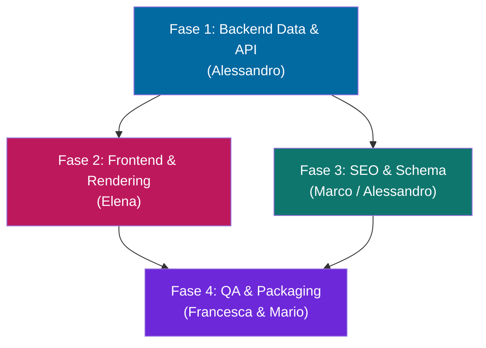

# Master Plan — Ottimizzazione Prestazioni NTN Journal

> **Versione Target:** 2.4.6 → **2.5.0** (MINOR: nuova architettura data-layer e ottimizzazione UI)
> **Assegnazione Lavori:** Management Core (Alessandro, Elena, Marco, Francesca)
> **Obiettivo:** Abbattere il TTFB, migliorare il punteggio LCP di Google e alleggerire il carico del server MySQL/PHP.

---

## Modello Architetturale e Dipendenze

> [!IMPORTANT]
> **Fase 1 è propedeutica:** L'implementazione delle static cache e dei transient nel backend fornirà un substrato solido che il Frontend (Fase 2) andrà a sfruttare (ad es. `ntn_get_igdb_data`).

---

## Fase 1 — Backend, Data Layer e API Caching
**Responsabile:** Alessandro (CTO / Lead Backend)
**Workspace Target:** `NTN_Journal_Core_Plugin/ntn-journal-core/`

Questa fase neutralizza i "Table Scan" sul DB e le query N+1, introducendo architetture di caching multilivello.

### 1.1 In-Memory Caching (Static Cache) per Query N+1
- **File target:** `inc/helpers.php` (o la copia canonica che manterremo nel plugin in `seo-extras.php`)
- **Azione:** Aggiungere variabili `static $cache = array();` all'interno di `ntn_get_hub_igdb_info()`, `ntn_get_igdb_data()`, `ntn_get_game_hub_url()` e `ntn_get_social_preview_image()`. Questo annulla i colli di bottiglia se le funzioni vengono chiamate 50 volte nello stesso page load.
- **Azione:** Consolidare i duplicati tra Tema e Plugin, conservando la copia logica nel Core Plugin (Regola 3 GEMINI.md).

### 1.2 Transients API per Entità Esterne (IGDB & AI)
- **File target:** `inc/ajax-igdb.php` e `inc/ai-summaries.php`
- **Azione:** Introdurre `get_transient()` e `set_transient()` per mascherare i rate limit esterni. Cacciare le ricerche di IGDB (`ntn_igdb_search_{MD5}`) e i riassunti AI (`ntn_ai_{MD5}`).

### 1.3 Refactoring Database: Redirect Manager
- **File target:** `inc/redirect-manager.php`
- **Azione:** Modificare il modello di salvataggio dei redirect. Abbandonare il grande array serializzato salvato su opzione singola in favore di opzioni frammentate basate su hash (`ntn_redir_{MD5_URL_SORGENTE}`). Rimuovere il caricamento massivo senza autoload su `template_redirect`.

### 1.4 Ottimizzazione Query Catalogo e `game_year`
- **File target:** `ntn-journal-core.php`, `inc/catalog-api.php`, `inc/rest-catalog.php`
- **Azione:** Registrare la tassonomia `game_year`. Convertire le vecchie logiche di `meta_query` numeriche sull'anno di uscita in `tax_query` (sfruttando gli indici di MySQL). 
- **Azione:** Nelle REST WP_Query inietta `'no_found_rows' => true` per prevenire il ricalcolo inutile di tutte le righe totali da parte di MySQL.
- **Azione:** In `inc/migrazione-igdb.php`, riscrivere lo scan basato su `EXISTS` in una query diretta `$wpdb` ultraveloce.

---

## Fase 2 — Frontend Optimization e Rendering
**Responsabile:** Elena (Lead Frontend / UI-UX Designer)
**Workspace Target:** `NTN_Journal_Theme_Reloaded/` (Parent e Child)

Questa fase si concentra sull'alleggerimento del DOM, sull'eliminazione del blocco di render (JS/CSS) e sull'ottimizzazione del LCP.

### 2.1 Transients in Homepage
- **File target:** `front-page.php` (Parent)
- **Azione:** Cacciare integralmente con Transients i risultati delle 5 grandi `WP_Query` della homepage (Evidenza, Ultime Notizie, Editoriali, Pubblicazioni, Recensioni) con TTL ragionevole, semplificando in parallelo le query di fallback.
- **Azione:** Introdurre static cache sulle funzioni frontend accessorie (es. `ntn_calculate_reading_time`, `ntn_get_primary_category`).

### 2.2 Unblocking JS e Esternalizzazione
- **File target:** `header.php`, `front-page.php`, `inc/enqueue.php` (Parent & Child)
- **Azione:** Estrarre il JavaScript inline dal `header.php` e portarlo in `assets/js/theme-ui.js`. Fare lo stesso per il carousel in `assets/js/carousel.js`.
- **Azione:** Tramite filtro `script_loader_tag`, iniettare l'attributo `defer` in script pesanti come `live-search.js` e limitarne l'enqueue solo ai template in cui è stampato il searchform.
- **Azione:** Eliminare i costosi controlli `file_exists()` sull'enqueue del Tailwind CSS. Se possibile, aggiungere la minificazione del CSS Tailwind nella CLI.

### 2.3 Largest Contentful Paint (LCP) e Thumbnails
- **File target:** `archive-videogioco.php`, `template-parts/content-game-card.php`
- **Azione:** Rimuovere l'attributo hardcoded `loading="lazy"` e scriverlo dinamicamente a seconda di `$wp_query->current_post`. Le primissime immagini della pagina devono usare `fetchpriority="high"`.
- **Azione:** Registrare in backend e usare qui la nuova image size `ntn-mini-thumb` (80x80) per smettere di scaricare payload fotografici giganteschi sui widget piccoli.

---

## Fase 3 — SEO, Schema & Sanitization
**Responsabile:** Marco (Security & Compliance) affiancato da Alessandro
**Workspace Target:** `inc/seo-extras.php`, `inc/schema-markup.php`

### 3.1 Consolidamento Generatori Schema
- **Azione:** Unificare in una helper function `ntn_get_game_platforms_for_schema()` la logica estrattiva delle piattaforme di gioco, attualmente duplicata 3 volte tra file diversi.

### 3.2 Hooks e Regex
- **Azione:** Spostare `ntn_journal_cleanup_third_party_og` dall'hook universale `init` al più appropriato `template_redirect` (eseguito solo in visualizzazione pagine front).
- **Azione:** Wrappare l'inserimento dei filtri di intercettazione Yoast/RankMath in un `add_action( 'init', ..., 20 )` assicurandoci che i plugin target siano caricati.
- **Azione:** Sostituire le lente `preg_replace()` del generatore di Indice (TOC) con rapide operazioni `str_replace()` / `substr_replace()`.

---

## Fase 4 — QA, Conformità SemVer e Packaging
**Responsabili:** Francesca (CQO) e Mario (CHRO & Chief Architect)

A completamento delle modifiche, scatta il protocollo di rilascio vincolante.

- [ ] **Test di Stabilità (PHP 8.2):** Lanciare `php audit_test_suite.php` nella root. Nessun log, nessun avviso, pass rate 100%.
- [ ] **Sincronizzazione 4 Header (SemVer 2.5.0):**
  - Aggiornare `ntn-journal/style.css`
  - Aggiornare `ntn-journal-reloaded/style.css`
  - Aggiornare header e costante in `ntn-journal-core.php`
- [ ] **Housekeeping Archivi:** Spostare preventivamente in `archive/` gli attuali `.zip` di versione 2.4.6.
- [ ] **Generazione ZIP (PowerShell):** Creare `ntn-journal-parent-2.5.0.zip`, `ntn-journal-child-reloaded-2.5.0.zip` e `ntn-journal-core-2.5.0.zip` seguendo le specifiche (assenza di nested version folder, forward slash).
- [ ] **Consegna:** Handoff finale e changelog per il CEO.
